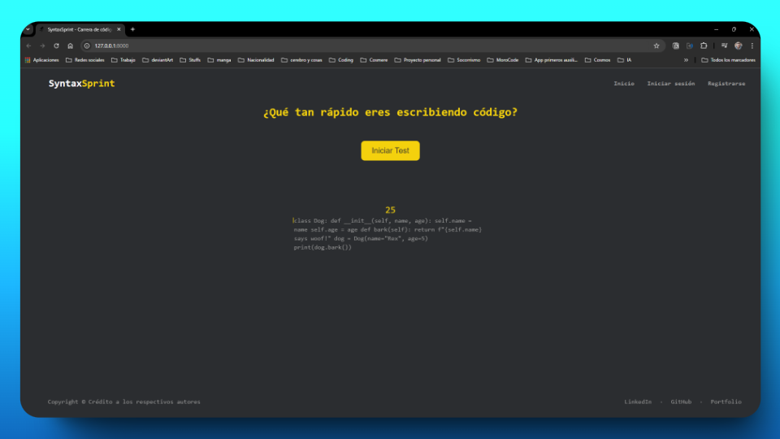

# SyntaxSprint - Carrera de código

SyntaxSprint es una aplicación web diseñada para ayudar a los usuarios a mejorar su velocidad de escritura en código. Los usuarios pueden realizar tests de escritura de código y registrar su rendimiento (palabras por minuto y precisión) en su perfil. La aplicación proporciona un historial de resultados y calcula los promedios de rendimiento.



## Características

- **Test de escritura de código:** Los usuarios pueden realizar tests de velocidad escribiendo fragmentos de código en múltiples lenguajes (Python, JavaScript, TypeScript, HTML, CSS, SQL, Java, Go).
- **Sistema de input avanzado:** Implementación inspirada en MonkeyType con:
  - Tracking de timing de teclas (tiempo entre pulsaciones, duración de cada tecla)
  - Detección de AFK (Away From Keyboard)
  - Tracking de errores por segundo
  - Manejo de atajos de teclado y teclas especiales
  - Soporte para IME (Input Method Editor)
- **Registro de resultados:** Los resultados se guardan automáticamente en el perfil del usuario, incluyendo palabras por minuto (WPM), precisión y tiempo.
- **Historial de resultados:** Los usuarios pueden ver un historial de sus resultados anteriores.
- **Promedio de rendimiento:** Se calcula y muestra el promedio de WPM y precisión en el perfil del usuario.
- **Tema claro/oscuro:** Los usuarios pueden alternar entre tema oscuro y claro.

## Requisitos

- Python 3.x
- Django 5.2.17
- jQuery 3.x

## Instalación (Para desplegarlo en local)

1. **Clona el repositorio:**

   ```bash
   git clone https://github.com/tu_usuario/syntaxsprint.git
   cd syntax_sprint
   ```

2. **Crea un entorno virtual y actívalo:**

   ```bash
   python -m venv venv
   source venv/bin/activate # Linux/Mac
   venv/Scripts/activate # Windows
   ```

3. **Instala las dependencias:**

   ```bash
   # Desarrollo (incluye lint, tests y auditoría de dependencias)
   pip install -r requirements-dev.txt

   # Solo producción
   pip install -r requirements.txt
   ```

4. **Aplica las migraciones:**

   ```bash
   python manage.py makemigrations
   python manage.py migrate
   ```

5. **Inicia el servidor:**

   ```bash
   python manage.py runserver
   ```

6. **Accede a la aplicación:**

   Abre tu navegador y ve a `http://127.0.0.1:8000/`.

## Estructura del Proyecto

```
syntax_sprint/
├── manage.py
├── backend/                # Aplicación principal (modelos, vistas, URLs, tests)
├── syntax_sprint/          # Configuración de Django
├── templates/              # Plantillas HTML
└── static/                 # Archivos estáticos
    ├── css/                # Estilos CSS
    └── js/                 # JavaScript
```

## Despliegue en Render

La aplicación está preparada para Render:

- Web Service con Gunicorn.
- PostgreSQL de InsForge mediante `DATABASE_URL`.
- Estáticos con WhiteNoise y `collectstatic`.
- Variables de entorno para `SECRET_KEY`, `DEBUG`, `ALLOWED_HOSTS`,
  `CSRF_TRUSTED_ORIGINS` y `TRUST_PROXY_HEADERS`.

La guía completa, el checklist y la rotación de la `SECRET_KEY` están en
[`DEPLOY.md`](DEPLOY.md). El blueprint está en [`render.yaml`](render.yaml).

## Uso

1. **Registro e Inicio de Sesión:**

   - Los usuarios pueden registrarse y luego iniciar sesión para poder registrar su _score_.

2. **Realizar un Test:**

   - Después de iniciar sesión, los usuarios pueden seleccionar un lenguaje de programación y comenzar un test de escritura de código.
   - Los resultados se guardarán automáticamente en su perfil.

3. **Ver Resultados:**

   - Los usuarios pueden ver su historial de resultados y sus promedios de WPM y precisión en la página de perfil.

## Contribución

Si deseas contribuir al proyecto:

1. Haz un fork del repositorio.
2. Crea una rama con tu nueva funcionalidad (`git checkout -b feature/nueva-funcionalidad`).
3. Realiza un commit de tus cambios (`git commit -m 'Añadir nueva funcionalidad'`).
4. Haz push a la rama (`git push origin feature/nueva-funcionalidad`).
5. Abre una Pull Request.

## Licencia

Este proyecto está licenciado bajo la Licencia MIT

## Contacto

Para preguntas o soporte, puedes contactarme en [oswaldofonseca159@gmail.com](mailto:oswaldofonseca159@gmail.com) o a través de mis redes sociales:

- [LinkedIn](https://www.linkedin.com/in/oswaldo-fonseca-gonzalez/)
- [GitHub](https://github.com/Chorexxs)
- [Portfolio](https://chorexxs-portfolio.dev/)

## _Proyecto inspirado en [monkeytype.com](https://monkeytype.com/)_
